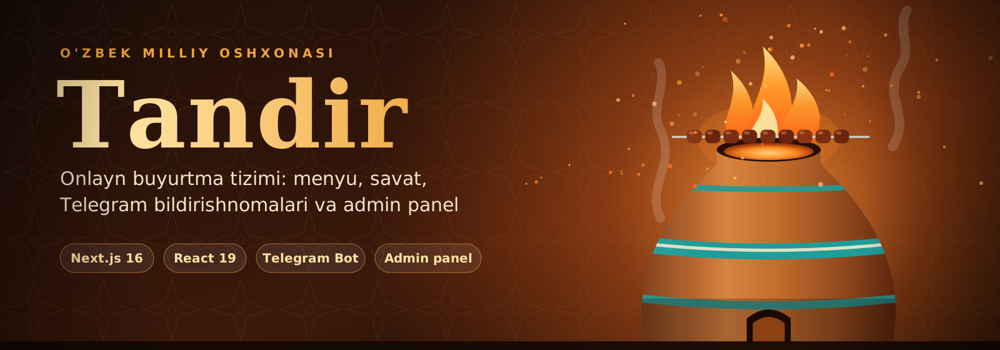
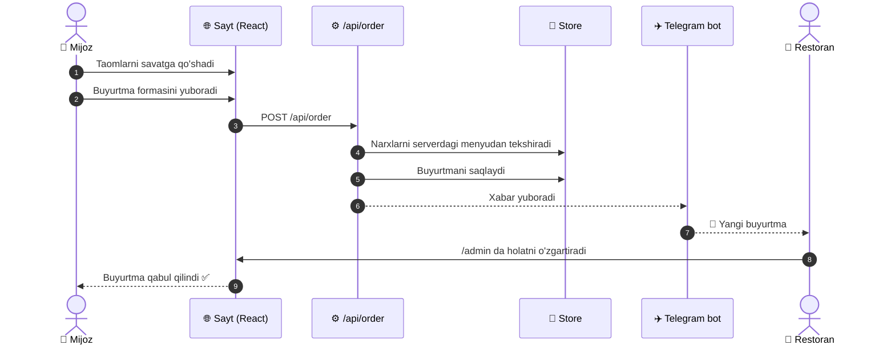
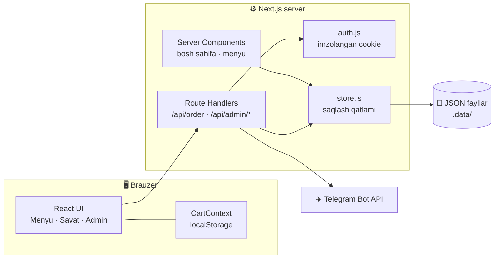

<div align="center">

<br/>


 
**[✨ Imkoniyatlar](#-imkoniyatlar) · [🧭 Qanday ishlaydi](#-qanday-ishlaydi) · [🧰 Texnologiyalar](#-texnologiyalar) · [🚀 Ishga tushirish](#-ishga-tushirish) · [🗺️ Rejalar](#️-rejalar)**
 
</div>
<br/>
> **Tandir** — restoran uchun to'liq ishlaydigan onlayn buyurtma tizimi. Mijoz taom tanlaydi va buyurtma beradi, restoran egasi esa buyurtmani **bir soniyada Telegramda** ko'radi va **admin paneldan** boshqaradi.
 
<br/>
## ✨ Imkoniyatlar
 
<table>
<tr>
<td width="33%" valign="top">
### 🍽️ Menyu
34 ta taom, 8 ta kategoriya, jonli qidiruv va filtr. Ommabop taomlar belgi bilan ajralib turadi.
 
</td>
<td width="33%" valign="top">
### 🛒 Smart savat
Soni o'zgartirish, o'chirish, jami summa. Sahifa yangilansa ham savat saqlanib qoladi.
 
</td>
<td width="33%" valign="top">
### 🔔 Telegram
Har bir buyurtma tayyor xabar bo'lib botga keladi: mijoz, telefon, manzil, taomlar va summa.
 
</td>
</tr>
<tr>
<td width="33%" valign="top">
### 📦 Buyurtmalar boshqaruvi
*Yangi → Tayyorlanmoqda → Yo'lda → Yetkazildi.* Ro'yxat har 20 soniyada o'zi yangilanadi.
 
</td>
<td width="33%" valign="top">
### 🍖 Menyu muharriri
Taom qo'shish, tahrirlash, yashirish va o'chirish. Rasmni tugma bilan yuklash mumkin.
 
</td>
<td width="33%" valign="top">
### 📱 Responsive dizayn
Telefon, planshet va kompyuterda bir xil qulay. Silliq animatsiyalar va zamonaviy ko'rinish.
 
</td>
</tr>
</table>
<br/>
## 🧭 Qanday ishlaydi
 
### Buyurtma yo'li
 

 
### Arxitektura
 

 
<br/>
## 🧰 Texnologiyalar
 
<div align="center">

</div>
| Qism | Texnologiya | Nima uchun |
|---|---|---|
| **Framework** | Next.js 16 (App Router, Turbopack) | Sahifalar, server komponentlar, API |
| **UI** | React 19 + Context API | Interaktiv interfeys, savat holati |
| **Dizayn** | Sof CSS, `next/font` | CSS o'zgaruvchilari, Grid, Flexbox, animatsiyalar |
| **Backend** | Route Handlers | Buyurtma, kirish, menyu va rasm API'lari |
| **Bildirishnoma** | Telegram Bot API | Buyurtma xabarlari |
| **Ma'lumotlar** | JSON fayllar (`.data/`) | Alohida qatlam, keyin bazaga ulanadi |
 
<br/>
## 🛡️ Xavfsizlik
 
<details>
<summary><b>Qanday himoya qilingan? (ochish uchun bosing)</b></summary>
<br/>
| Himoya | Qanday amalga oshirilgan |
|---|---|
| 💰 Narxni soxtalashtirish | Narxlar mijozdan emas, **serverdagi menyudan** olinadi |
| 🔐 Admin kirishi | Parol `timingSafeEqual` bilan solishtiriladi, sessiya HMAC bilan imzolanadi |
| 🍪 Cookie | `httpOnly`, `sameSite=lax`, production'da `secure` |
| 🚪 Admin API | Har bir so'rovda sessiya tekshiriladi |
| 🖼️ Rasm yuklash | Tur fayl nomiga emas, **ichidagi baytlarga** qarab aniqlanadi, 3 MB limit |
| 💬 Telegram matni | Mijoz yozgan matn HTML'dan tozalanadi |
| 🔑 Maxfiy kalitlar | `.env.local` da turadi, GitHub'ga yuklanmaydi |
 
</details>
<br/>
## 🚀 Ishga tushirish
 
**Talablar:** [Node.js](https://nodejs.org/) 20+, [Git](https://git-scm.com/) va (ixtiyoriy) [@BotFather](https://t.me/BotFather) orqali yaratilgan Telegram bot.
 
```bash
# 1. Loyihani yuklab oling
git clone https://github.com/Samirjon018/tandir-restaurant.git
cd tandir-restaurant
 
# 2. Kutubxonalarni o'rnating
npm install
 
# 3. Sozlamalar faylini yarating
cp .env.example .env.local        # Windows: copy .env.example .env.local
 
# 4. Ishga tushiring
npm run dev
```
 
Sayt: **http://localhost:3000** · Admin panel: **http://localhost:3000/admin**
 
<details>
<summary><b>⚙️ <code>.env.local</code> sozlamalari</b></summary>
<br/>
```env
TELEGRAM_BOT_TOKEN=bot_tokeningiz
TELEGRAM_CHAT_ID=chat_id_raqamingiz
ADMIN_PASSWORD=admin_parolingiz
ADMIN_SECRET=uzun_tasodifiy_matn
```
 
| O'zgaruvchi | Tavsif |
|---|---|
| `TELEGRAM_BOT_TOKEN` | [@BotFather](https://t.me/BotFather) bergan bot tokeni |
| `TELEGRAM_CHAT_ID` | Buyurtmalar keladigan chat ID (botga `/start` yozib, `getUpdates` orqali topiladi) |
| `ADMIN_PASSWORD` | `/admin` sahifasiga kirish paroli |
| `ADMIN_SECRET` | Sessiyani imzolash uchun maxfiy kalit |
 
`ADMIN_SECRET` yaratish:
 
```bash
node -e "console.log(require('crypto').randomBytes(32).toString('hex'))"
```
 
> 💡 Telegram sozlanmasa ham sayt ishlaydi. Buyurtmalar admin panelda ko'rinadi, faqat bildirishnoma yuborilmaydi.
 
</details>
<details>
<summary><b>📁 Loyiha tuzilishi</b></summary>
<br/>
```
src/
├── app/
│   ├── page.js                  # Bosh sahifa
│   ├── menu/page.js             # Menyu
│   ├── cart/page.js             # Savat va buyurtma formasi
│   ├── contacts/page.js         # Kontaktlar
│   ├── admin/page.js            # Admin panel
│   └── api/
│       ├── order/route.js       # Buyurtma qabul qilish + Telegram
│       └── admin/
│           ├── login/           # Kirish
│           ├── logout/          # Chiqish
│           ├── orders/          # Buyurtmalarni boshqarish
│           ├── menu/            # Menyuni boshqarish
│           └── upload/          # Rasm yuklash
├── components/                  # Header, Footer, MenuGrid, AdminPanel, Reveal ...
├── context/CartContext.js       # Savat holati (localStorage bilan)
├── data/menu.js                 # Boshlang'ich menyu va kategoriyalar
└── lib/
    ├── auth.js                  # Sessiya va parol tekshiruvi
    └── store.js                 # Ma'lumotlarni saqlash qatlami
public/
├── images/                      # Statik rasmlar
└── uploads/                     # Admin yuklagan rasmlar
```
 
</details>
<br/>
## 📸 Skrinshotlar
 
> Skrinshotlarni `docs/` papkasiga qo'ying va quyidagi izohni oching.
 
<!--
<table>
<tr>
<td></td>
<td></td>
</tr>
<tr>
<td></td>
<td></td>
</tr>
</table>
-->
 
<br/>
## 🎓 Bu loyihada nimalarni o'rgandim
 
- **Next.js App Router**: server va client komponentlar, layout, metadata
- **Route Handlers**: o'z backend API'larini yozish
- **Autentifikatsiya**: imzolangan cookie, parolni xavfsiz solishtirish
- **Fayl yuklash**: `FormData`, rasmni baytlari bo'yicha tekshirish
- **Tashqi API**: Telegram Bot API bilan ishlash
- **State management**: React Context va `localStorage`
- **UI**: responsive dizayn, animatsiyalar, `IntersectionObserver`
- **Arxitektura**: saqlash qatlamini alohida faylga ajratish (bazaga oson o'tish uchun)
<br/>
## ⚠️ Muhim eslatma
 
Hozirgi versiyada buyurtmalar va menyu **mahalliy JSON fayllarda** (`.data/`), rasmlar esa `public/uploads/` da saqlanadi. Bu kompyuterda yaxshi ishlaydi, lekin **Vercel kabi serverless platformalarda fayl saqlanmaydi**. Internetga joylashdan oldin `src/lib/store.js` ni ma'lumotlar bazasiga, rasm yuklashni esa bulutli saqlashga ulash rejalashtirilgan. Saqlash qatlami alohida bo'lgani uchun qolgan kod o'zgarmaydi.
 
<br/>
## 🗺️ Rejalar
 
| | Vazifa | Holat |
|---|---|---|
| ✅ | Menyu, qidiruv va kategoriya filtri | Tayyor |
| ✅ | Savat va buyurtma formasi | Tayyor |
| ✅ | Telegram bildirishnomalari | Tayyor |
| ✅ | Admin panel (buyurtmalar va menyu) | Tayyor |
| ✅ | Admin paneldan rasm yuklash | Tayyor |
| 🔜 | Ma'lumotlar bazasi (Supabase / Neon) | Keyingi qadam |
| 🔜 | Rasmlarni bulutda saqlash | Keyingi qadam |
| 🔜 | Vercel'ga joylash | Keyingi qadam |
| 💡 | Ikki tilli interfeys (o'zbek / rus) | G'oya |
| 💡 | Onlayn to'lov (Click / Payme) | G'oya |
| 💡 | Mijoz buyurtma holatini kuzatishi | G'oya |
 
<br/>
## 👨‍💻 Muallif
 
<div align="center">
**Samirjon Abdurakhimov**
Web dasturlash o'quvchisi · One World Academy, Samarqand
 
[](https://github.com/Samirjon018)
 
<br/>
Loyiha yoqqan bo'lsa, ⭐ qo'yishni unutmang!
 
</div>